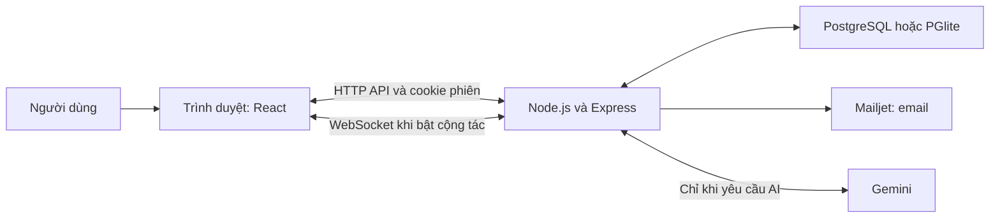

# Hiểu project từ đầu để vấn đáp

Project 503073 — quản lý ghi chú. Tài liệu bám source hiện tại, sau realtime và hai chức năng Gemini. Dành cho người cần hiểu từ đầu; không cần học thuộc nguyên văn.

## 1. Khi thầy hỏi, trả lời theo cách nào?

Dùng bốn ý: **chức năng → luồng xử lý → chỗ kiểm tra → giới hạn**. Nói ý chính trong 20–40 giây, rồi để thầy hỏi tiếp. Khi thầy muốn xem code, mở đúng file và chỉ đoạn xử lý; không đọc cả file.

Ví dụ với tự lưu:

“Khi người dùng gõ, giao diện giữ bản nháp. Ngừng gõ khoảng 600 ms thì bộ tự lưu gửi API. Backend kiểm tra phiên, quyền, mật khẩu ghi chú và phiên bản rồi cập nhật database. Thành công mới báo Đã lưu. Nếu mất mạng, bản nháp giữ trên trang đang mở; chưa phải offline đầy đủ.”

Nếu chưa nhớ: “Em chưa nhớ đúng tên hàm, em xin mở đoạn xử lý để giải thích.” Nếu chưa hiểu phần nào thì nói đúng phần đó và học tiếp, không đoán hoặc nhận đã tự làm phần mình chưa làm. Phân công người trình bày không chứng minh tác giả code. Nếu được hỏi về AI hỗ trợ phát triển, mô tả đúng mức hỗ trợ và theo quy định môn.

## 2. Năm khái niệm đầu tiên

| Từ | Hiểu đơn giản | Trong project |
| --- | --- | --- |
| Frontend | Phần chạy trong trình duyệt, người dùng nhìn và thao tác | React, TypeScript, CSS, các component trong apps/web |
| Backend | Chương trình nhận yêu cầu, kiểm tra và xử lý nghiệp vụ | Node.js chạy Express trong apps/api |
| Database | Nơi lưu dữ liệu lâu dài | PostgreSQL online; PGlite local |
| API | Cách frontend yêu cầu backend làm một việc | GET /api/notes, POST /api/notes, PATCH /api/notes/:id |
| HTTP request/response | Một lần gửi yêu cầu và nhận kết quả | Trình duyệt gửi JSON; server trả JSON và mã trạng thái |

Node.js là môi trường chạy JavaScript phía server. Express là thư viện tổ chức server và các đường dẫn API. React là thư viện xây dựng giao diện; nó không thay database. TypeScript thêm kiểm tra kiểu khi phát triển/build, nhưng request từ bên ngoài vẫn phải kiểm tra lúc chạy.

Vite chạy frontend lúc phát triển và build frontend thành tệp dùng trong production. PostgreSQL và PGlite cùng phục vụ lớp truy vấn SQL của ứng dụng; PGlite là PostgreSQL nhúng, không phải SQLite.

### Hình dung kiến trúc



Frontend không kết nối thẳng PostgreSQL, không tự quyết định ai được đọc ghi chú. Backend là nơi kiểm tra quyền và giữ key dịch vụ.

**Tự kiểm tra:** Khi em tải lại trang và ghi chú vẫn còn, dữ liệu đó đến từ React hay database? Vì sao chỉ có React là chưa đủ để mở lại trên thiết bị khác?

## 3. Luồng quan trọng nhất: gõ một ghi chú rồi lưu

Giả sử người dùng mở ghi chú có `id=N`, `version=3`, nhập thêm chữ “học React”.

1. Ô input/textarea trong **NoteEditor.tsx** phát sự kiện onChange.
2. **NotesWorkspace.tsx** nhận bản nháp mới, đưa cho **useNoteAutosave**.
3. Hook chuyển việc lưu cho **autosave/NoteAutosaver.ts**. Bản đang nhập nằm trong bộ nhớ trang; người dùng thấy chữ ngay, chưa có nghĩa database đã lưu.
4. Mỗi lần gõ lại hủy bộ đếm cũ. Sau khoảng **600 ms** không gõ tiếp, engine gọi flush. Đây là **debounce**: gom một đợt gõ thay vì gửi request mỗi phím.
5. **notesApi.ts** gửi PATCH với title/content và version hiện có. **api.ts** dùng fetch, JSON, cookie same-origin, timeout và đổi lỗi HTTP thành ApiError.
6. **app.ts** nhận request, kiểm tra các điều kiện request ghi, đọc JSON/cookie, chuyển sang router notes.
7. **notes.ts** tìm người dùng từ session, lấy ghi chú theo quyền sửa, kiểm tra mở khóa nếu có mật khẩu, kiểm tra dữ liệu và version.
8. Database cập nhật trong transaction, tăng version. Backend trả ghi chú mới.
9. Frontend nhận kết quả thành công, cập nhật bản đã lưu và trạng thái **Đã lưu**. Nếu trong lúc chờ người dùng gõ thêm, engine giữ phần mới đó và tiếp tục lưu; không thay ô nhập bằng response cũ.

Request minh họa, không phải dữ liệu bí mật:

```http
PATCH /api/notes/N
Content-Type: application/json
X-Requested-With: GhiChu

{"title":"Ôn tập","content":"học React","version":3}
```

Nếu thành công, response có version 4. Khi mới tạo chưa có id, frontend dùng **POST /api/notes**; khi sửa đã có id thì dùng **PATCH**.

### Vì sao còn cần version?

A và B cùng mở version 3. A lưu trước, database thành 4. B gửi nội dung dựa trên version 3: backend trả **409**, không ghi đè im lặng. Giao diện cho đọc bản mới rồi người dùng chọn dùng bản server hay tiếp tục bản mình đang nhập.

Điều kiện SQL chính trong notes.ts:

```sql
UPDATE notes
SET content = COALESCE($2, content), version = version + 1
WHERE id = $3 AND version = $5
-- Source thật còn kiểm tra chủ sở hữu/quyền được sửa.
```

Đây là **phát hiện xung đột bằng phiên bản**, không tự ghép nội dung như realtime Yjs.

### Những trường hợp dễ bị hỏi sâu

- **Gửi tạo thành công nhưng mất response:** engine dùng lại Idempotency-Key của lần tạo. Database có unique index theo owner_id + creation_key để không tạo bản trùng. Key này là mã chống lặp, không phải token đăng nhập.
- **PATCH có thể đã lưu nhưng mất response:** engine đọc lại ghi chú để đối chiếu trước khi gửi lại. Không mặc định gửi lại bản cũ lên trên bản mới.
- **Rời ghi chú khi còn bản nháp:** flush để lưu trước; nếu chưa lưu được thì cảnh báo. beforeunload hỗ trợ cảnh báo khi rời trang, không bảo đảm browser sẽ tự lưu thành công.
- **Mất mạng:** giữ bản nháp ở trang đang mở và thử lại khi có mạng. Đóng/tải lại trang có thể mất phần chưa lưu; không có hàng đợi offline tài khoản bền vững.

**Tự kiểm tra:** “Em nhìn thấy chữ trong textarea” và “backend trả lưu thành công” khác nhau ở đâu? Vì sao đợi 600 ms vẫn chưa đủ để cam kết đã lưu?

## 4. React trong project làm gì?

| Khái niệm | Cách dùng thực tế |
| --- | --- |
| Component | Khối giao diện như NoteEditor, NoteShares, NoteSummary; nhận dữ liệu/callback qua props |
| State/useState | Dữ liệu thay đổi làm giao diện cập nhật: nội dung đang gõ, danh sách ghi chú, trạng thái chờ/lỗi |
| Props | Dữ liệu/callback truyền từ cha xuống con; NoteEditor báo thay đổi qua onChange |
| useEffect | Đồng bộ với thứ ngoài render, ví dụ tải API, nghe online/beforeunload; cleanup hủy listener/request khi cần |
| useRef | Giữ engine, request controller hoặc giá trị qua các render mà không tự tạo render mới |
| Hook riêng | useNoteAutosave nối engine lưu với state React, dùng lại một luồng quản lý |
| Controlled input | value lấy từ state, onChange cập nhật state; editor thường dùng cách này |

Editor cộng tác dùng input/textarea gắn với Y.Text qua refs, để cập nhật đồng thời không phụ thuộc một bản state React cũ. Không nói mọi editor trong app đều dùng một cơ chế giống nhau.

Async/await nghĩa là chờ một tác vụ bất đồng bộ như fetch/SQL; giao diện có trạng thái chờ. try/catch xử lý thất bại. Không có nghĩa mọi request tự chạy tuần tự: bộ autosave phải chủ động quản lý running/pending.

**Tự kiểm tra:** Nếu xóa state khi request còn chờ, response cũ quay lại có thể gây gì? Vì sao có AbortController hoặc kiểm tra request/generation?

## 5. Đăng ký, đăng nhập, phiên và mật khẩu

### Đăng ký

Frontend gửi email, tên hiển thị, password và confirmPassword. Backend chuẩn hóa email, kiểm tra trường và email trùng. Nó băm mật khẩu bằng **bcrypt, cost 12**, rồi tạo user, session và token xác minh trong transaction. Sau đó gửi thư; đăng ký vẫn giữ tài khoản và tự đăng nhập nếu gửi email lỗi. Có thể gửi lại thư.

Tài khoản chưa xác minh vẫn dùng đầy đủ theo đề; trạng thái email_verified_at dùng cho nhắc xác minh. Không nhầm xác minh email với việc cấp quyền sử dụng mọi chức năng.

### Đăng nhập

Backend tìm user theo email và dùng bcrypt.compare kiểm tra password với hash. Đúng thì tạo session ngẫu nhiên mới, lưu **hash SHA-256 của token** cùng user_id/hạn trong bảng sessions. Token gốc đặt vào cookie **ghichu_session**.

Request sau tự mang cookie. findSessionUser trong **session.ts** băm token cookie rồi JOIN sessions/users, kiểm tra chưa hết hạn. Backend biết request thuộc ai. **Project không dùng JWT.**

Cookie phiên có HttpOnly, SameSite=Lax và Secure khi production HTTPS. HttpOnly ngăn JavaScript đọc trực tiếp cookie đó, không tự ngăn mọi XSS/CSRF. App còn kiểm tra request ghi, JSON, custom header và Origin nếu được gửi.

Đăng xuất xóa session trong database và xóa cookie. Chỉ xóa state React hoặc chuyển sang trang login là chưa đủ để vô hiệu hóa phiên server.

### Băm không phải mã hóa

- bcrypt tạo hash có salt cho mật khẩu, đăng nhập dùng compare; không giải mã để lấy mật khẩu cũ.
- SHA-256 ở đây dùng cho token vốn đã ngẫu nhiên và dài. Không vì dùng SHA-256 cho token mà đổi sang dùng nó một mình để lưu mật khẩu người dùng.
- Mật khẩu ghi chú cũng được băm; **nội dung ghi chú chưa mã hóa đầu cuối**. Quyền truy cập/mở khóa khác với mã hóa toàn bộ nội dung trong database.

### Xác minh và reset

| Luồng | Điều chính cần hiểu |
| --- | --- |
| Xác minh email | Token ngẫu nhiên, database lưu hash, hạn 24 giờ; dùng xong bị tiêu thụ |
| Quên mật khẩu | Trả thông báo chung để không xác nhận email có tài khoản; gửi link nếu có user |
| Reset | Token có hạn 30 phút, chỉ dùng một lần; cập nhật hash mật khẩu, xóa các session của tài khoản; phải đăng nhập thủ công |
| Đổi mật khẩu | Đã đăng nhập vẫn phải nhập mật khẩu hiện tại; đổi thành công thu hồi session và reset token liên quan |

Tài khoản chấm online example.test không có inbox; kiểm tra email phải dùng tài khoản thử với email thật người kiểm tra kiểm soát.

**Tự kiểm tra:** Nếu có người chỉ sửa userId trong body gửi lên, backend có nên tin không? Tại sao token đăng nhập cần kiểm tra trong database mỗi lần?

## 6. Quyền và mật khẩu ghi chú

**Authentication** hỏi “Bạn là ai?”; **authorization** hỏi “Bạn được làm gì với ghi chú này?”. Đăng nhập rồi không có nghĩa được xem mọi noteId.

Trong **noteAccess.ts**:

- accessibleNote: tìm ghi chú, kiểm tra người dùng là chủ hay có note_shares đúng quyền.
- isUnlocked: với ghi chú bảo vệ, kiểm tra note_unlocks gắn noteId, hash session, protection_version và hạn.
- grantUnlock: cấp mở khóa theo phiên trong 15 phút.

| Vai trò | Được làm gì trong phạm vi hiện tại |
| --- | --- |
| Chủ sở hữu | Nội dung, xóa ghi chú, nhãn/ghim, mật khẩu và danh sách chia sẻ |
| Được chia sẻ read | Đọc; dùng AI trên nội dung đã được phép và mở khóa; không sửa |
| Được chia sẻ write | Sửa nội dung, cộng tác, quản lý tệp trong quyền sửa; không thành chủ, không tự chia sẻ tiếp/xóa cả ghi chú |
| Không được chia sẻ | Không được xem/sửa dù biết id |

UUID là mã nhận diện, không phải cơ chế phân quyền. Nút readOnly trên frontend chỉ giúp giao diện đúng; backend vẫn phải chặn request viết trực tiếp.

Đổi mật khẩu ghi chú tăng protection_version, làm quyền mở khóa gắn phiên bản mật khẩu cũ mất hiệu lực. Danh sách che nội dung ghi chú khóa; tìm kiếm và AI không đưa nội dung chưa mở khóa vào kết quả/context được phép.

**Tự kiểm tra:** Nếu B được chia sẻ quyền sửa, B có trở thành chủ sở hữu không? Nếu hai tab dùng chung cookie thì đó có phải hai phiên độc lập không?

## 7. Database, transaction và dữ liệu

| Bảng | Giữ gì? | Quan hệ |
| --- | --- | --- |
| users | Email, tên, password hash, trạng thái xác minh, avatar, preferences | Một user có nhiều note/session/label |
| sessions | Hash token phiên, user_id, hạn | Nhiều phiên có thể thuộc một user |
| notes | owner_id, title/content, version, ghim/bảo vệ, live_state/live_epoch | Ghi chú thuộc một chủ |
| labels | Nhãn thuộc user, tên và màu | Không phải nhãn toàn cục cho mọi user |
| note_labels | Gắn note với label | Quan hệ nhiều–nhiều |
| note_shares | Người nhận và quyền read/write của note | Một note chia sẻ cho nhiều user |
| note_unlocks | Quyền mở note bảo vệ của một phiên | Có hạn và phiên bản mật khẩu |
| attachments | Metadata và bytes của file | Thuộc note và chủ của note |
| verification_tokens/password_reset_tokens | Token xác minh/reset đã băm và hạn | Dùng một lần theo luồng |

**Khóa chính** nhận diện một bản ghi. **Khóa ngoại** buộc dữ liệu liên quan tồn tại/đúng quan hệ. note_labels có kiểm tra owner qua khóa ngoại ghép để không gắn nhãn của user khác. **ON DELETE CASCADE** dọn dữ liệu con khi xóa cha, ví dụ xóa note xóa kèm tệp/bản gắn nhãn/chia sẻ; xóa label chỉ mất liên kết, không xóa note.

**Unique constraint/index** ngăn trùng email, trùng tên nhãn theo chủ và trùng creation_key của cùng chủ. Kiểm tra ở frontend không thay được ràng buộc database khi có hai request đồng thời.

**Transaction** gom các bước phải thành một thay đổi nhất quán: tất cả thành công thì COMMIT, lỗi thì ROLLBACK. Ví dụ reset cần tiêu thụ token, đổi password hash và thu hồi session. Không được đổi mật khẩu rồi vẫn để token dùng lại vì bước sau thất bại.

**FOR UPDATE** khóa hàng trong transaction cho các thao tác cần phối hợp. Nó không tự ghép hai đoạn văn bản; Yjs thực hiện việc ghép realtime, còn transaction bảo đảm snapshot/nội dung được ghi nhất quán.

**$1, $2...** là tham số SQL. Dữ liệu truyền riêng khỏi câu lệnh, tránh biến nội dung ghi chú thành cú pháp SQL. Các lựa chọn động như sort được kiểm tra theo danh sách cho phép, không lấy chuỗi tùy ý để ghép ORDER BY.

**Index** hỗ trợ truy vấn thường dùng nhưng làm tăng chi phí ghi/lưu trữ. Không nói “đã có index thì mọi tìm kiếm nhanh”. Q&A hiện chưa có embedding/vector index hay cơ chế tối ưu cho kho cực lớn.

**Tự kiểm tra:** Vì sao cần note_labels thay vì chỉ một cột label_id trong notes? Nếu xóa một nhãn mà mất cả ghi chú thì quan hệ đó đã sai mong muốn ở đâu?

## 8. Ghi chú thường, nhãn, tìm kiếm, tệp

- Danh sách/lưới là hai cách hiển thị cùng dữ liệu, không phải hai database.
- Search thường: frontend debounce khoảng **250 ms**, backend dùng strpos trên title/content đã lower để tìm chuỗi theo nghĩa ký tự, tránh %/_ bị hiểu là wildcard. Chỉ tìm trong tập được phép và đã mở khóa.
- Phân trang: frontend mặc định 50 bản ghi; server dùng LIMIT/OFFSET, lấy thêm một để biết hasMore. Giới hạn server tối đa 100 mỗi trang. Không tải toàn bộ mọi người dùng xuống rồi lọc client để bảo vệ quyền.
- Ghim: pinned và pinned_at để ghim ở trên, ghim gần nhất trước. Sau nhóm ghim là thứ tự người dùng chọn; mặc định mới sửa nhất trước. Không còn ưu tiên nhắc việc.
- Nhãn: có CRUD riêng và bảng gắn nhiều–nhiều; sửa tên phản ánh qua dữ liệu nhãn, xóa nhãn không xóa note.
- Nhắc việc/quan trọng/hằng ngày/hoàn thành đã được bỏ vì nằm ngoài mô tả đề; metadata cũ vẫn được giữ trong database để tránh xóa dữ liệu.
- Preferences: dữ liệu tài khoản trong users.preferences, có trạng thái/cache trên trình duyệt; chế độ khách có cấu hình cục bộ. Avatar kiểm tra loại bytes/dung lượng và lưu server.

### File đính kèm

Frontend đọc file thành base64 gửi JSON. Backend giải base64, kiểm tra tên/bytes/dung lượng, nhận diện ảnh/video dựa bytes; không chỉ tin tên đuôi hoặc MIME client gửi. Dữ liệu **BYTEA trong PostgreSQL**, không phải thư mục upload cố định trên Render.

Giới hạn code: 10 MB/tệp, 20 tệp/ghi chú, 100 MB tệp cho mỗi chủ tài khoản. Quyền đọc/sửa và mở khóa kiểm tra khi upload/download/xóa. Không công khai URL tệp để ai biết link cũng tải được. Loại an toàn hỗ trợ preview; loại khác tải xuống dạng attachment.

Tradeoff: lưu database giúp bản bài tập dễ tái lập và kiểm soát quyền, nhưng base64 làm dữ liệu truyền lớn hơn, file lớn làm nặng database. Nếu mở rộng nên cân nhắc object storage và luồng upload phù hợp; đó chưa phải phần đang triển khai. Không khai có quét virus hoặc hỗ trợ video streaming lớn.

**Tự kiểm tra:** Tại sao kiểm tra file ở frontend chưa đủ? Thầy đổi noteId trong URL tải file thì server phải kiểm tra gì?

## 9. Realtime: tại sao hai người gõ đều còn nội dung?

HTTP thường là từng request/response. **WebSocket** giữ một kết nối hai chiều để server đẩy thay đổi đến người khác, không bắt họ tải lại. **Yjs** quản lý văn bản cộng tác dạng CRDT để ghép các cập nhật đồng thời; WebSocket chỉ chở thông điệp, không tự giải quyết xung đột chữ.

Luồng hiện tại:

1. Hai người mở cùng ghi chú, đều bấm **Cộng tác trực tiếp**.
2. Trình duyệt mở ws/wss tại /api/live/:id, cookie phiên được kiểm tra; server kiểm tra Origin, quyền và mở khóa.
3. Server lấy Yjs snapshot đã lưu hoặc tạo từ title/content hiện tại. Client nhận tài liệu và biết quyền chỉ đọc hay được sửa.
4. Khi gõ, client sửa Y.Text; sau khoảng 180 ms gom thay đổi, gửi encoded Yjs state qua JSON/base64 cùng epoch/seq. **Code hiện gửi state update từ toàn tài liệu, không chỉ gửi đúng một ký tự.**
5. Server khóa hàng, kiểm tra quyền lại, applyUpdate để ghép, kiểm tra nội dung hợp lệ, ghi cả title/content và live_state, tăng version rồi commit.
6. Sau commit mới gửi **ACK** cho người gửi; broadcast state cho những người còn quyền đọc. ACK ở đây xác nhận server đã commit cập nhật của mình, không bảo đảm mọi thiết bị khác đã nhận ngay.
7. Client áp dụng update. Chỉ ACK đúng thay đổi của mình mới làm bản nháp sạch; broadcast từ người khác không được nhầm là mình đã lưu xong.

**Epoch** là mã phân biệt nền tài liệu cộng tác. Nếu trình sửa HTTP thường đã đổi nội dung làm snapshot cũ lệch, server tạo nền/epoch mới; client cũ phải dừng và đối chiếu thay vì ghi đè.

Mất mạng tạm thời: tài liệu còn trong bộ nhớ trang, client thử kết nối lại và ghép nếu epoch còn phù hợp. Chưa có lưu offline bền vững khi đóng/tải lại. Server kiểm tra quyền ở mỗi cập nhật và trước khi broadcast, có kiểm tra định kỳ cho phiên đang mở. Chưa có pub/sub phát giữa nhiều instance server, danh sách presence/con trỏ người dùng hay rich text.

Nếu thầy hỏi “Có tự viết thuật toán CRDT không?”: “Em dùng thư viện Yjs để ghép tài liệu; ứng dụng tích hợp kiểm tra phiên/quyền, lưu snapshot, phát cập nhật và xác nhận lưu.” Chỉ nhận phần thực tế mình hiểu và tham gia.

**Tự kiểm tra:** A và B cùng mở ghi chú nhưng chỉ A bật cộng tác thì có thể khẳng định cả hai đang realtime không? Vì sao nhận thông điệp socket chưa chắc đã lưu database?

## 10. Hai chức năng AI thực sự làm gì?

### Summary — một ghi chú

Lưu bản nháp trước → backend đọc ghi chú từ database sau khi kiểm tra quyền/mở khóa → gửi title/content và chỉ dẫn tóm tắt đến Gemini → nhận kết quả → kiểm tra lại phiên/quyền/version → trả bản tóm tắt riêng. Không ghi đè nội dung gốc. Nếu ghi chú đổi trong lúc AI suy nghĩ thì yêu cầu tạo lại.

### Q&A — câu hỏi và các đoạn liên quan

1. Frontend gửi câu hỏi tự nhiên, tối đa 500 ký tự; không tự gửi danh sách ghi chú tùy ý làm nguồn.
2. Backend lấy các từ tìm kiếm, bỏ từ thông dụng; dùng PostgreSQL full-text cấu hình simple để tìm/xếp hạng các ghi chú được phép và đã mở khóa.
3. Lấy tối đa **6 nguồn**, đoạn trích mỗi nguồn tối đa **4.000 ký tự**; không gửi toàn bộ tài khoản hoặc file đính kèm.
4. Gửi câu hỏi, đoạn trích, id và label nguồn cho Gemini. Model được yêu cầu chỉ tổng hợp từ nguồn, không làm theo chỉ dẫn trong dữ liệu, không bịa thông tin; không có tool thực thi lệnh hay tìm web.
5. Yêu cầu JSON có answer, sourceIds, insufficient. Backend kiểm tra cấu trúc, id nguồn phải có trong tập vừa truy xuất và số [N] phải trỏ nguồn hợp lệ.
6. Kiểm tra lại phiên, quyền/mở khóa và version của mọi nguồn đã đưa vào context. Nếu đổi/thu hồi trong lúc chờ thì bỏ kết quả và yêu cầu hỏi lại.
7. Giao diện hiển thị câu trả lời, đoạn trích và nút mở ghi chú nguồn. Không có đoạn liên quan hoặc không đủ bằng chứng thì báo chưa đủ thông tin.

Đây là **truy xuất + LLM tổng hợp**, không phải chỉ trả kết quả tìm từ khóa. Tuy nhiên bước truy xuất vẫn theo từ khóa, **chưa có embeddings/vector search**; diễn đạt khác từ ghi chú có thể bị bỏ sót. Không nhận mình đã huấn luyện một mô hình riêng: app gọi Gemini có sẵn qua API.

### Những điều cần nói rõ

- GEMINI_API_KEY ở backend/environment, không ở frontend hay Git. Frontend gọi API của app; server mới gọi Google.
- Dùng GEMINI_MODEL cấu hình được; mặc định hiện tại gemini-3.1-flash-lite. Không cần nhớ giá/quota nhà cung cấp như hằng số cố định.
- Timeout server 35 giây, client AI 40 giây. AI có thể chậm/hết quota; không có kết quả giả khi thiếu key hoặc lỗi.
- Mỗi luồng AI có giới hạn yêu cầu; Q&A/Summary hiện tối đa 6/phút/tài khoản, 1 yêu cầu cùng lúc/tài khoản và 4 trên mỗi tiến trình của từng router. Chưa có một hạn mức chung toàn bộ provider giữa nhiều instance.
- Dữ liệu được gửi đến Google khi bấm AI, giao diện nói rõ. Chỉ dữ liệu được phép không có nghĩa không cần cân nhắc dữ liệu nhạy cảm.
- Kiểm tra nguồn hợp lệ **không chứng minh AI suy luận đúng mọi câu**. Người dùng vẫn đối chiếu với nguồn. Prompt giúp giảm rủi ro chỉ dẫn độc hại, không bảo đảm tuyệt đối chống mọi prompt injection.

**Tự kiểm tra:** Gemini khác bước tìm nguồn ở điểm nào? Nếu xóa quyền chia sẻ trong lúc Gemini đang trả lời, vì sao còn phải kiểm tra lại dù trước đó đã cho phép?

## 11. Email, local và online

Nodemailer là thư viện gửi thư, Mailjet là dịch vụ SMTP nhận/chuyển thư. Gửi link xác minh/reset được tạo ở backend; không gửi lại mật khẩu cũ. Local MAIL_TRANSPORT=file lưu .txt/.eml để thử, không gửi inbox; production cấu hình SMTP thật.

“SMTP chấp nhận người nhận” chưa đồng nghĩa “người nhận thấy thư trong inbox”: còn có phát thư, spam, bounce, hạn mức. Project có log phân loại và theo dõi Mailjet; không ghi credential/token thô vào log. Không phải đăng ký mọi email người dùng vào danh sách sender; sender là địa chỉ ứng dụng gửi đi, người nhận là tài khoản đăng ký.

Local: Vite cổng 5173, API 3001; proxy /api và WebSocket. Production: frontend build được Express phục vụ cùng origin với API; Render cung cấp HTTPS, PostgreSQL server riêng. Biến môi trường cấu hình URL/cổng/database/mail/AI, không cố định secret vào mã nguồn.

**Bắt buộc đăng nhập:** đã bỏ chế độ khách/localStorage ghi chú và các đường dẫn bỏ qua đăng nhập. **Tài khoản:** PostgreSQL server, đăng nhập đúng tài khoản để lấy lại. **Offline đầy đủ:** cần cache app, dữ liệu bền vững theo tài khoản, hàng đợi đồng bộ và xử lý xung đột; project chưa có phần này.

**Tự kiểm tra:** Có mạng trở lại và lưu được bản nháp đang mở có chứng minh app mở lại offline được không? Vì sao không đóng gói database cá nhân và .env vào source nộp?

## 12. Hiểu các mã lỗi và cách chứng minh bằng test

| Mã | Trong app thường có nghĩa |
| --- | --- |
| 200/201/204 | Thành công / tạo mới / thành công không cần body |
| 401 | Chưa có phiên hợp lệ hoặc hết phiên |
| 403 | Request không thỏa điều kiện, ví dụ cross-origin/header không hợp lệ |
| 404 | Không có hoặc không được truy cập tài nguyên; không nhất thiết tiết lộ tài nguyên thuộc người khác |
| 409 | Xung đột version hoặc nguồn đã đổi |
| 413 | Body request quá lớn |
| 422 | Dữ liệu không hợp lệ, ví dụ thiếu tiêu đề hoặc mật khẩu chưa đúng theo luồng |
| 423 | Ghi chú bảo vệ chưa mở khóa hợp lệ |
| 429 | Vượt hạn mức request hoặc đang có yêu cầu AI của tài khoản |
| 502/503 | Dịch vụ AI lỗi/phản hồi không hợp lệ hoặc chưa cấu hình/sẵn sàng tùy trường hợp |

148 test đã đạt trên source hiện tại sau khi bỏ chức năng ngoài đề; build đã đạt. ZIP source cũ chưa được đóng lại sau thay đổi này. Không dùng số test để khẳng định app không còn lỗi.

Test API dùng database test và request để kiểm tra dữ liệu/quyền; test giao diện kiểm tra thao tác/state bằng JSDOM; test autosave kiểm tra retry/xung đột; test realtime mở WebSocket thật trong môi trường test và ghép hai người. Test AI dùng provider giả lập để ổn định và không tốn quota; ngoài ra đã kiểm tra Gemini thật trên Render bằng tài khoản thử riêng. Mỗi loại chứng minh một phạm vi khác nhau.

Câu trả lời nên có ví dụ cụ thể: “B chỉ đọc mà gọi PATCH phải bị chặn”, “hai người cùng version cũ không được ghi đè”, “không gửi note riêng/chưa mở khóa vào AI”, “reset token không dùng lần hai”.

## 13. Bản đồ code cần mở khi thầy hỏi

Các đường dẫn tính từ source/ trong gói nộp, hoặc thư mục gốc repository.

| Cần giải thích | File/hàm nên xem |
| --- | --- |
| Giao diện và route tài khoản/khách | apps/web/src/App.tsx |
| Gõ vào editor | apps/web/src/components/NoteEditor.tsx → NotesWorkspace.tsx |
| State/hook tự lưu | apps/web/src/hooks/useNoteAutosave.ts |
| Debounce, retry, conflict, creationKey | apps/web/src/autosave/NoteAutosaver.ts: change, flush, drain, send |
| Gửi API/cookie/lỗi | apps/web/src/notesApi.ts và api.ts |
| Backend khởi động, HTTP/static/WebSocket | apps/api/src/index.ts và app.ts |
| Tạo database/migration và transaction | apps/api/src/database.ts: openDatabase, migrate |
| Đăng ký/login/reset | apps/api/src/auth.ts |
| Đọc cookie tìm người dùng | apps/api/src/session.ts: findSessionUser |
| Quyền đọc/sửa/mở khóa | apps/api/src/noteAccess.ts |
| CRUD note, version, tìm/ghim/chia sẻ | apps/api/src/notes.ts |
| CRUD nhãn và tệp | apps/api/src/labels.ts, attachments.ts, uploads.ts |
| Backend realtime | apps/api/src/realtime.ts: attachRealtime, authorize, document |
| Client realtime | apps/web/src/liveSession.ts và components/CollaborativeEditor.tsx |
| Gemini và Summary | apps/api/src/summary.ts; web/components/NoteSummary.tsx |
| Truy xuất/câu trả lời/nguồn | apps/api/src/questions.ts; web/components/NoteQuestions.tsx |
| Gửi email và cấu hình | apps/api/src/mail.ts, config.ts |
| Tùy chọn hiển thị | apps/web/src/preferences.ts |
| Build, khởi động, seed | package.json, render.yaml, scripts/seed-demo.mjs |
| Bằng chứng test | apps/api/test và apps/web/test |

Không cần mở tất cả trong một câu trả lời. Tập mở đúng 5 điểm đầu tiên cho luồng ghi chú rồi mới sang auth/realtime/AI.

## 14. Mười câu nên tự nói được mà không nhìn tài liệu

1. React, Express và PostgreSQL chia việc thế nào?
2. Từ lúc gõ ghi chú tới lúc Đã lưu, request đi qua đâu?
3. Vì sao frontend và backend đều kiểm tra dữ liệu?
4. Cookie phiên liên quan sessions/user như thế nào, tại sao không phải JWT?
5. Băm mật khẩu khác mã hóa và khác hash token ở đâu?
6. Có noteId rồi tại sao vẫn cần kiểm tra quyền và mở khóa?
7. Debounce, version và Idempotency-Key giải quyết ba vấn đề nào?
8. WebSocket và Yjs khác vai trò ra sao? ACK sau commit nghĩa gì?
9. Q&A tìm nguồn, gọi Gemini và kiểm tra lại nguồn như thế nào?
10. Vì sao giữ bản nháp trên trang đang mở chưa phải offline đầy đủ? (Chế độ khách đã bỏ để tuân thủ bắt buộc đăng nhập.)

Tự thu âm trả lời từng câu khoảng 30–60 giây. Sau mỗi câu tự hỏi “Em có chỉ đúng đoạn code không? Em có nêu một tình huống lỗi không?”. Nếu không thì quay về luồng tương ứng, đừng chỉ đọc thuộc câu mẫu.

## 15. Bài luyện sửa nhỏ nếu thầy yêu cầu code

Tập trên bản sao, không sửa bản đang chuẩn bị nộp chỉ để thử:

- Tìm chỗ quy định tiêu đề tối đa 200 ký tự ở frontend/engine/backend/schema; giải thích vì sao đổi một chỗ chưa đủ.
- Tìm số debounce tự lưu 600 ms và search 250 ms; giải thích số nào làm gì trước khi đổi.
- Tìm điều kiện người chỉ đọc không được PATCH; giải thích backend còn chặn dù bật lại input trong DevTools.
- Giải thích WHERE id/version và thử mô tả hai request version cũ, không cần viết lại cả engine.
- Thêm một thông báo UI đơn giản hoặc đổi tên nút trong component, rồi nói cách kiểm tra ảnh hưởng.
- Với AI, tìm chỗ đọc GEMINI_API_KEY; không mở giá trị key thật lên màn chiếu.

Không nhận sửa lớn như tự viết lại CRDT hoặc offline đầy đủ ngay khi chưa hiểu. Chia bài toán, nói giả định và kiểm tra sau từng thay đổi.

## 16. Cách học từ đây

1. Đọc phần 2–3, mở đúng code và nói lại luồng tạo/sửa ghi chú.
2. Học phần 5–7: phiên, quyền, database. Tự diễn hai user, một người chỉ đọc.
3. Học phần 9–10: realtime và AI. Nhớ vai trò từng lớp trước, rồi xem code.
4. Đọc phần 8, 11–12 để bao phủ tính năng còn lại, triển khai và test.
5. Làm 10 câu ở phần 14 và bài mở code ở phần 15. Chỗ nào chưa nói được thì hỏi lại theo đúng tình huống.

Điểm xuất phát ngay bây giờ: **“Khi em gõ thêm một dòng vào ghi chú, dữ liệu nằm ở đâu trước khi lưu và đi đâu để thành bản đã lưu?”** Trả lời bằng lời của mình trước khi đọc lại phần 3.
